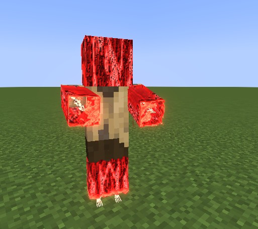

A `model` track draws an entity again through its own renderer, with every vertex going through Kinesis's model
material. The renderer doesn't need to know about Kinesis. Armour, held items and render layers all come along, and so
do models from other mods, GeckoLib included.



## The mask

The mask gives every pixel of the model a distance, and a front travels through those distances.

| `mode` | Distance |
|---|---|
| `point` | From `origin` |
| `plane` | Along `axis`, from `origin` |
| `bones` | Along the skeleton, from the centre of the `root` bone outward |
| `noise` | Pure noise, for an even dissolve |
| `none` | No mask |

`progress` is how far the front has travelled, in blocks. Animate it with a curve. `noise` roughens the edge.

By default, everything the front has passed is visible. `invert: true` flips that, so the model disappears as the
front passes, which turns growth into disintegration.

## Layers

Behind the front, layers stack in order. Each lasts `width` blocks behind the front; the last lasts forever.

```json
"layers": [
  { "width": 0.16, "texture": "kinesis:material/blood", "tiling": 5, "glow": 0.35 },
  { "width": 0.28, "texture": "kinesis:material/bone", "tiling": 4 },
  { "width": 0.42, "texture": "kinesis:material/muscle", "tiling": 3 },
  { "texture": "entity" }
]
```

`entity` is the model's own texture. Any other texture tiles across the model and keeps the model's transparency, so
cut-out parts stay cut out. `edge` adds a glowing rim right at the front.

## Hiding the original

`hide_original: true` stops the entity's normal rendering while the track runs, shadow included. It is how an
effect starts from nothing (regeneration) or replaces the entity (petrification).

## Snapshots and afterimages

`snapshot: true` freezes the model at the moment the track starts. The copy outlives the entity, so it works for
death dissolves and statues.

`afterimages` leaves frozen copies behind as the entity moves, each fading out:

```json
"afterimages": { "count": 7, "interval": 0.05, "life": 0.35 }
```

## Bending the surface

`deform` changes the shape of the model on the graphics card, so it costs a few numbers per frame whatever the
model. Every field is animatable:

```json
"deform": {
  "bulge_at": { "bone": "right_arm:center" },
  "bulge": "0.09 + 0.07 * sin(age * 5)",
  "bulge_radius": 0.32,
  "swell": 0.01,
  "ripple": 0.01,
  "ripple_size": 0.25,
  "ripple_speed": 1.5
}
```

- `swell` pushes the whole surface out, like `inflate`.
- `bulge` swells the surface within `bulge_radius` of `bulge_at`: a flexing muscle, a growth, something moving
  under the skin.
- `ripple` runs waves over the surface.
- `melt` goes from 0 to 1: the model sinks to the ground and spreads into a puddle (`spread` sets how wide),
  unevenly, so some parts hang on and drip. It works on the live, animating model.

Block models only have vertices at their corners, so while `bulge`, `ripple` or `melt` is in use the copy's faces
are cut into small cells as they are captured, letting the surface bend between the corners. `swell` alone pushes
each box out evenly and needs no extra cells. `kinesis:flex` and `kinesis:melt` show these.

## Cutting a model in two

`slice` cuts the model along a plane and draws each half on its own:

```json
"slice": {
  "origin": [0, 1, 0],
  "normal": [1, 0.25, 0],
  "gap": { "keys": [[0, 0], [0.08, 0], [1, 0.35, "out_quad"]] },
  "tilt": { "keys": [[0, 0], [0.1, 0], [0.55, 88, "in_quad"]] },
  "cap_color": [1.2, 0.08, 0.1, 1]
}
```

`origin` and `normal` are in the entity's frame, measured from its feet. `gap` moves the halves apart, `tilt` tips
each one over around the foot of the cut, and `drop` slides the half on the `normal` side down. Where the cut opens
the model, the inside is filled with `cap_color`, darker deeper in; values above 1 glow. Use `snapshot: true` to cut
a frozen pose, or leave it off and the halves keep animating. See `kinesis:slice`.

## Breaking a model into chunks

`shatter` freezes the model and breaks it into up to 64 chunks that burst out, tumble, fall and come to rest on the
ground:

```json
"shatter": {
  "pieces": 40,
  "origin": [0, 1.1, 0.2],
  "force": 2.4,
  "lift": 2.2,
  "spin": 420,
  "gravity": 16,
  "inner_color": [0.32, 0.06, 0.06, 1]
}
```

The model is cut once, when the track starts: faces are split into squares `size` blocks wide, so chunks have ragged
edges rather than following whole faces, and the squares are grouped into `pieces` chunks of mixed sizes. After that
the flight of every chunk is worked out on the graphics card from its index and the time, so a frame costs the same
with 4 chunks or 64. `time` defaults to `age`, the seconds since the track started; hold it at a value to freeze the
burst mid-air, or run it backwards to put the model together again. `inner_color` fills the broken faces. See
`kinesis:shatter`.

## Ghosts and holograms

`offset`, `scale` and `inflate` move, resize and puff out the copy. With an additive material and a fresnel fade you
get a hologram:

```json
{
  "type": "model",
  "offset": [1.3, 0, 0],
  "inflate": 0.01,
  "layers": [{ "texture": "kinesis:material/hologram", "tiling": 6 }],
  "material": { "blend": "add", "fresnel": { "power": 1.6, "strength": 1.8, "color": [0.6, 1.6, 2.2, 1], "fade": true } }
}
```

## How regeneration is built

`kinesis:regen` uses only general features:

1. A `model` track with `hide_original` hides the evaporated mob from the start. Its `bones` mask stays at 0 for the
   first part of the effect.
2. A `particles` track gathers dark remnants inward with an attractor and curl noise.
3. A single cell appears: a `mesh` sphere at `body:center`, pulsing through an expression.
4. Cells divide: a `particles` track whose particles start the `kinesis:regen_split` effect when they die.
5. Veins grow along the skeleton: a `tendrils` track with `path: bones`.
6. Organs pulse: `mesh` spheres with fresnel, scaled by `pulse(time * 9.5, 10)` for a heartbeat.
7. The body forms: the mask's `progress` sweeps out from the torso through blood, bone, muscle and skin.
8. Steam rises from the surface and the original returns.

Open `assets/kinesis/kinesis/effects/regen.json` in the Kinesis jar to read it in full.
