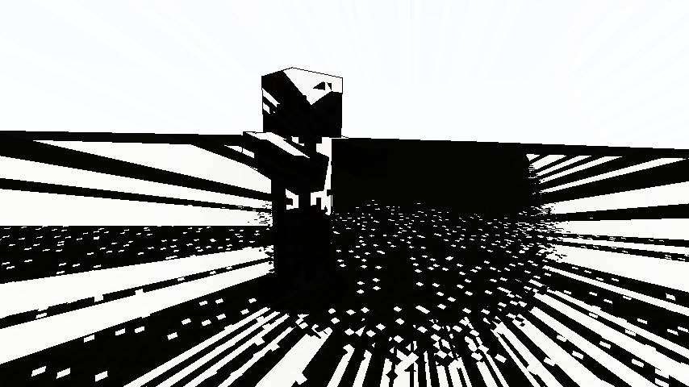

A `screen` track adds full-screen effects while it runs. Every value is a number, so curves shape them:

```json
{ "type": "screen", "end": 0.4, "shake": { "keys": [[0, 1], [1, 0]] }, "chromatic": 1.2, "flash": { "keys": [[0, 0.6], [0.2, 0]] } }
```

| Field | Effect |
|---|---|
| `shake` | Camera shake |
| `flash`, `flash_color` | A flash of colour |
| `chromatic` | Red and blue split toward the edges |
| `vignette`, `vignette_color` | Darkened or coloured edges |
| `impact`, `impact_invert` | Black-and-white manga impact frame with ink outlines |
| `lines` | Radial speed lines toward the track |
| `desaturate`, `tint`, `invert` | Colour grading |
| `warp` | Lens bulge or pinch around the track on screen |

Strength fades with the viewer's distance and is gone beyond `range`.



## Spheres in the world

Give a screen track a `radius` and the colour effects only apply inside that sphere around the track, measured
against the actual scene depth. Animate the radius and you have a time-stop dome:

```json
{
  "type": "screen",
  "radius": { "keys": [[0, 0], [0.12, 40, "out_quad"]] },
  "edge": 1.5,
  "edge_color": [1.4, 0.8, 2.4, 1],
  "invert": { "keys": [[0, 1], [0.1, 0]] },
  "desaturate": { "keys": [[0.1, 0], [0.16, 0.85]] }
}
```
