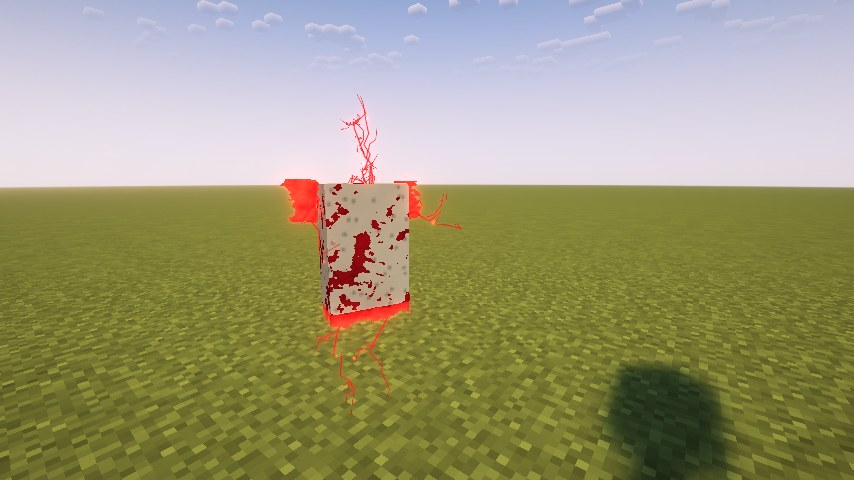

Kinesis works with Oculus and shaderpacks without any setup.

Shaderpacks replace Minecraft's rendering with their own passes. Effects drawn the usual way get lit, shadowed and
post-processed by the pack, and often come out invisible, black or smeared. Kinesis sidesteps all of that: it draws
every effect in its own pass, after the shaderpack has finished the frame. It depth-tests against the scene, then
runs its own bloom, heat haze and screen effects.

What that means in practice:

- Effects look the same with and without a pack.
- Effects are hidden behind terrain and entities as you'd expect.
- The pack doesn't light or shadow effects. Nearly all visual effects glow anyway.
- Bloom and heat haze come from Kinesis, not the pack, so they behave the same under any pack.

## Model copies that replace an entity

A `model` track that looks like the entity itself is the exception. If it has no `mask`, no layers other than the
entity's own texture, and no glow, fresnel, special shading or additive blending, then while a pack is in use it is
drawn as an ordinary entity, in the same batch as the world's mobs. The pack lights it, shades it and puts it in its
shadow map, so a copy replacing a mob or player looks exactly like the original.

`deform`, `slice` and `shatter` still apply: for these copies they are worked out on the CPU instead of the graphics
card, which costs about a quarter of a millisecond per copy. Cut faces are filled with solid polygons in
`cap_color`; values above 1 are clamped, since the pack decides what glows. Broken chunks show the model's texture
on their inner faces instead of `inner_color`.

Copies with Kinesis materials (holograms, glowing fronts, layered surfaces) keep the Kinesis pass, since the pack
cannot draw those looks.
